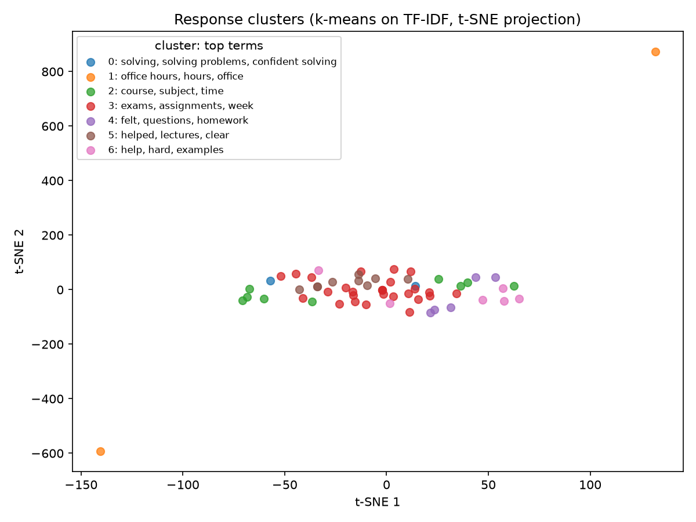
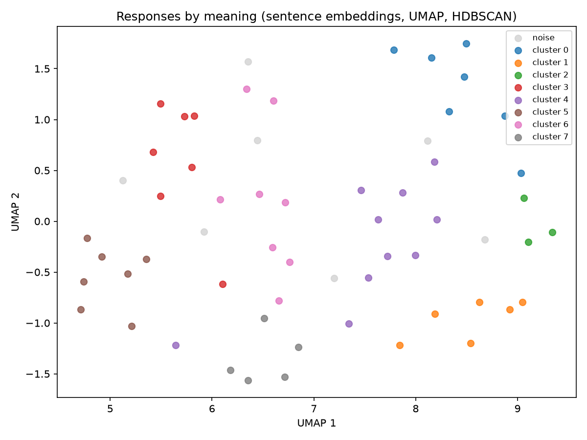
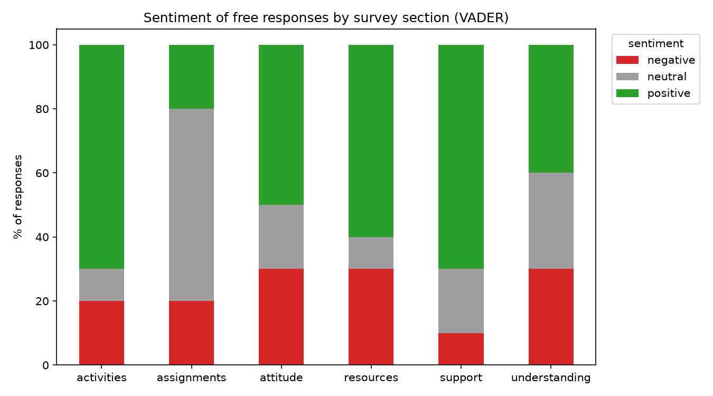
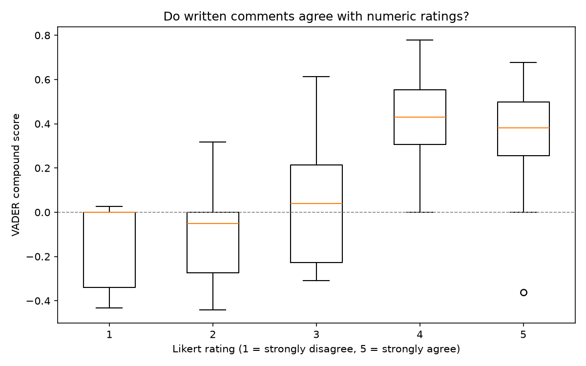

# Student Feedback Opinion Mining

[](https://github.com/nadeem015/student-feedback-nlp/actions/workflows/ci.yml)


Course surveys such as the **SALG** (Student Assessment of their Learning Gains) collect hundreds of free-text comments that nobody has time to read. This project summarises them automatically. It finds the **topics** students write about and measures how **positive or negative** they are. It also checks whether the comments agree with the students' numeric **Likert ratings**.

It is inspired by *Summarizing Students' Free Responses for an Introductory Algebra-Based Physics Course Survey Using Cluster and Sentiment Analysis*. It includes two pipelines you can compare:

| | Classic pipeline | Embedding pipeline |
|---|---|---|
| Text representation | TF-IDF (word and bigram counts) | Sentence embeddings (`sentence-transformers`) |
| Dimensionality reduction | PCA, then t-SNE (for plots) | UMAP |
| Clustering | k-means, with k chosen by silhouette score | HDBSCAN, which finds the number of clusters and flags outliers |
| Sentiment | VADER, plus an optional supervised TF-IDF + logistic regression model | (combine with the classic sentiment) |
| Needs | scikit-learn and VADER only (runs anywhere) | PyTorch (a model download of about 90 MB) |

TF-IDF can only group comments that share words. Embeddings group comments that share a **meaning**, so "the TA was great" and "office hours really helped" land together.

## Results

These results come from running both pipelines on the 60-response synthetic sample in CI. The charts below are regenerated automatically on every push.

| | Classic (TF-IDF + k-means) | Embeddings (MiniLM + UMAP + HDBSCAN) |
|---|---|---|
| Clusters found | 7 (k chosen by silhouette) | 8, plus 7 responses marked as noise |
| Cluster quality | silhouette 0.015, and one catch-all cluster holds 27 of 60 responses | coherent topics: homework, support and deadlines, textbook and worked examples, lectures and quizzes, course attitude |

| Sentiment check | Value |
|---|---|
| VADER label distribution | 31 positive, 15 neutral, 14 negative |
| Rank correlation, Likert rating vs. VADER score | **0.56**: written comments broadly agree with the ratings |
| VADER accuracy vs. human labels | 0.60 |
| Supervised TF-IDF + LR (45 train / 15 test) | 0.40: too little data, as expected |

**Takeaways:** on short comments, TF-IDF + k-means mostly groups responses by shared words and leaves one big mixed cluster. Sentence embeddings recover topics a person would recognise, and they flag the hard-to-place answers instead of forcing them into a cluster. VADER's agreement with the ratings is moderate. It misses domain phrases such as "challenging but fair", so human labels plus a supervised model would help on a real survey with a few hundred labelled responses.

| Classic topics (t-SNE) | Embedding topics (UMAP) |
|---|---|
|  |  |

| Sentiment by survey section | Comments vs. ratings |
|---|---|
|  |  |

Cluster summaries with example responses are in [`outputs/embedding_cluster_summary.txt`](outputs/embedding_cluster_summary.txt), and the full classic results are in [`outputs/summary.json`](outputs/summary.json).

## Quick start

```bash
python -m venv .venv
source .venv/bin/activate        # Windows: .venv\Scripts\activate
pip install -r requirements.txt

python run_classic.py --data data/sample_feedback.csv --supervised
```

For the embedding pipeline:

```bash
pip install -r requirements-embeddings.txt
python run_embeddings.py --data data/sample_feedback.csv
# higher quality, slower:  --model all-mpnet-base-v2
```

Everything is written to `outputs/`: charts, `processed_feedback.csv` (each response with its cluster and sentiment), `summary.json`, and cluster summaries.

### Use your own survey

Provide a CSV with one row per response:

| Column | Required | Meaning |
|---|---|---|
| `free_response` | yes | the comment (another column name works with `--text-col`) |
| `section` | no | survey section, used for the sentiment-by-section chart |
| `likert_1_5` | no | numeric rating, used for the Likert vs. sentiment comparison |
| `sentiment_label` | no | human label (`positive`, `neutral` or `negative`), used for `--supervised` and to score VADER |

Options for `run_classic.py`: `--clusters auto|N`, `--supervised`, `--text-col`, `--out`.

## How it works

1. **Cleaning:** lower-case the text, strip punctuation, and drop empty answers such as "N/A".
2. **Topics:** TF-IDF vectors are clustered with k-means. The number of clusters is chosen by the best silhouette score, and each cluster is described by its highest-weighted terms and most representative responses.
3. **Sentiment:** VADER, a lexicon- and rule-based model tuned for short informal text, scores each original comment from −1 to +1, with labels at ±0.05.
4. **Validation:** the rank correlation between Likert ratings and VADER scores shows whether the written comments match the ratings. If human labels exist, VADER's accuracy is reported and a supervised baseline is trained.
5. **Embedding alternative:** `sentence-transformers` embeddings are reduced with UMAP and clustered with HDBSCAN (built into scikit-learn 1.3 and later). Each cluster is summarised by its TF-IDF terms and the responses closest to its centroid.

## Project structure

```
feedback_nlp/
  preprocess.py   cleaning, TF-IDF
  cluster.py      PCA/t-SNE, k-means, silhouette-based k, cluster keywords and summaries
  sentiment.py    VADER, Likert agreement, supervised baseline
  visualize.py    charts
  embeddings.py   sentence-transformers + UMAP + HDBSCAN pipeline
run_classic.py    command-line runner for the classic pipeline
run_embeddings.py command-line runner for the embedding pipeline
data/sample_feedback.csv   60 synthetic responses across 6 SALG sections
tests/            pytest suite (runs in CI together with both pipelines)
```

## Data note

The original SALG survey data is private, so `data/sample_feedback.csv` contains **60 synthetic responses written for this project**. Its Likert scores and sentiment labels were assigned by hand. Results on it demonstrate the pipeline; they are not research findings.

## Limitations

- Short comments give sparse TF-IDF vectors, so silhouette scores for k-means are low. This is the main reason for the embedding pipeline.
- VADER doesn't understand course-specific phrases ("the exam was fair" reads as neutral) or sarcasm.
- The supervised model needs a few hundred labelled responses to beat VADER. The 60-row sample is only enough to show the workflow.

## License

[MIT](LICENSE)
